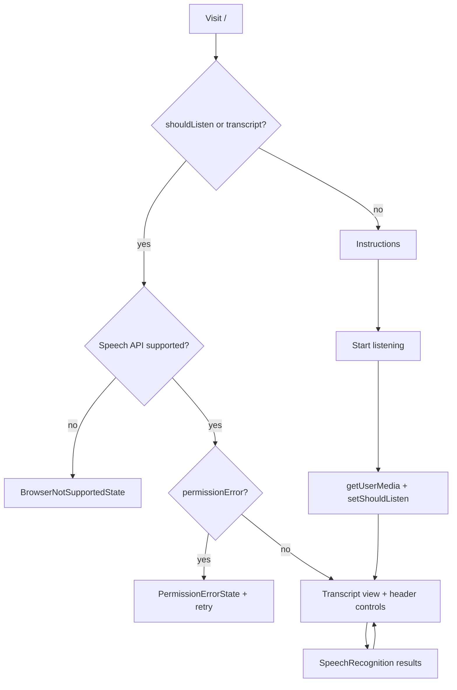

# Aid.me — Product specification

Authoritative product overview, current application state, and roadmap.  
Agent instructions: see [AGENTS.md](./AGENTS.md). Human setup: see [README.md](./README.md).

---

## 1. Product overview

### Product promise

**Closed captioning for your life** — place a phone or laptop where people are speaking, tap the microphone, and read large real-time captions. No account is needed for captions on your own device; an optional account lets you stream your captions live to people you invite, so they can follow along on their own phones.

### Target users

- People who are **deaf or hard of hearing** following in-person conversations
- Companions showing captions **face-to-face** across a table
- Anyone needing **live notes** from nearby speech (meetings, classrooms, casual talk)
- Users of the **Aid Hearing** iOS app (WebView wrapper) who want the same web experience

### Core workflows

1. **First visit:** Land on `/` → see instructions → tap mic → grant microphone → transcript view
2. **Return visit:** Tap header mic → listen → read auto-scrolling sentences + interim line
3. **Face-to-face:** On mobile, toggle “Face-to-face” to rotate captions for someone opposite
4. **Settings:** Open `/settings` to choose recognition language, caption size, and review keyboard shortcut help
5. **Help / trust:** Open `/about`, `/privacy`, `/terms` from footer
6. **Native wrapper:** Logo tap sends `ReactNativeWebView.postMessage("refresh")` when embedded
7. **Account:** `/sign-in` → Google, email + password (with forgot password and email verification), or a passwordless email link → `/account` for profile, sessions, and sign-out
8. **Live sharing (owner):** Signed in with a verified email → “Share live” → enter invitee emails → Email invite / Share sheet / Copy link → each finalized sentence streams to Firestore → “Stop sharing”
9. **Live viewing (invitee):** Open `/s/{sessionId}` → sign in with the invited, verified email → captions appear in real time; access ends immediately if the owner removes them or deletes the session

### Product goals

- Maximize **comprehension** (readable type, scroll to latest, stable listening loop)
- Minimize **friction** (no sign-up needed for captions, one-button listen, clear permission errors)
- Preserve **privacy** (transcripts are stored only while the user explicitly shares a session, readable only by invited verified emails, deletable from `/account`)
- Support **accessibility** (ARIA live regions, semantic button states, high contrast)
- Stay **compatible** with Chrome, Edge, Safari and the existing iOS shell

---

## 2. Current application state

*Verified against codebase on branch `dev` (merged with `origin/main`). Items marked **(inferred)** are not explicitly documented in code comments.*

### What the app does

Single-page transcription experience at `/` with global header (mic, logo/about, settings). Speech is captured in-browser, converted to text via `SpeechRecognition`, displayed as capitalized sentences with a trailing period, with interim partial text below. Listening stops automatically after 30 minutes or when the user toggles the mic off.

### Feature inventory

| Feature | Status | Implementation notes |
|---------|--------|----------------------|
| Continuous speech recognition | Shipped | `useListening` + singleton in `speechRecognition.ts` |
| Interim results | Shipped | Separate `interimTranscript` state |
| Auto-restart after `onend` | Shipped | 250ms delay; guarded by mount + `shouldListen` |
| Transcript cap (200 sentences) | Shipped | `MAX_TRANSCRIPT_LENGTH` |
| Instructions onboarding | Shipped | Shown when `!shouldListen && transcript.length === 0` |
| Unsupported browser UI | Shipped | `BrowserNotSupportedState` |
| Permission denied / retry | Shipped | `PermissionErrorState`, toasts from header |
| Network / service errors | Shipped | `ERROR_MESSAGES.NETWORK_ERROR` |
| Face-to-face flip (mobile) | Shipped | Zustand `isTranscriptFlipped`, `lg:hidden` toggle |
| Desktop auto-unflip | Shipped | `useMediaQuery` resets flip at `lg` |
| Auto-scroll transcript | Shipped | `scrollIntoView` on transcript changes |
| Listening timeout 30 min | Shipped | `Header` `useEffect` |
| Toast notifications | Shipped | Sonner in root layout |
| Error boundary | Shipped | `ErrorBoundary` in layout |
| PWA manifest | Shipped | `public/manifest.json` |
| iOS / Android app links | Shipped | `public/.well-known/*` |
| React Native refresh bridge | Shipped | Logo click → `postMessage("refresh")` |
| Language selection UI | **Shipped** | `LanguageSelect` + persisted `recognitionLanguage` in Zustand |
| Transcript copy to clipboard | **Shipped** | `CopyTranscriptButton` + `lib/transcript.ts` |
| Adjustable caption text size | **Shipped** | `CaptionSizeSelect` + persisted `captionSize` |
| Settings page | **Shipped** | `/settings` route with language, caption size, and shortcut help |
| Mic toggle keyboard shortcut | **Shipped** | Space via `useMicToggleShortcut` in `Header` |
| Transcript persistence (local) | **Not shipped** | In-memory only on the owner's screen; refresh clears (shared sessions keep their lines in Firestore) |
| User accounts | **Shipped** | Firebase Auth: Google (hidden in the iOS WebView), email/password with verification + reset, email link; `AuthListener` → `useAuthStore` |
| Live shared transcripts | **Shipped** | `sessions/{id}` + `lines/{id}` in Firestore; `LiveShareButton`/`LiveShareDialog`, `useLiveTranscriptSync`, viewer at `/s/[sessionId]`; access enforced by `firestore.rules` |
| Account page | **Shipped** | `/account`: profile name, verify email, your sessions (view/stop/delete), shared with you, sign out |
| Hard sign-out | **Shipped** | Footer + account page; ends an active share, clears auth-related storage, reloads to `/` |
| Google Analytics | **Shipped** | Firebase Analytics when `NEXT_PUBLIC_FIREBASE_MEASUREMENT_ID` is set |
| Firefox transcription | **Not supported** | No Web Speech API |
| Automated tests | **Partial** | Vitest for lib validation, speech module, route model |

### Current user flows (diagram)

### Integrations

| Integration | Role |
|-------------|------|
| Web Speech API | Core transcription (browser/vendor dependent) |
| Permissions API | Microphone status when available |
| `getUserMedia` | Explicit mic permission before listen |
| Sonner | Error toasts |
| Firebase Auth (`aidmehearing`) | Accounts; authorized domains include `aid.me`, `www.aid.me`, `localhost` |
| Cloud Firestore (`aidmehearing`, `(default)`, Standard, `nam5`) | Live shared sessions; rules + indexes deployed via `npm run deploy:rules` |
| Firebase Analytics | Usage analytics (optional env) |
| Next.js / Vercel **(inferred deploy)** | App hosting; no API routes or server actions in repo |
| Aid Hearing iOS app | WebView + universal links |

### Architecture summary

- **Client-rendered** Next.js 16 App Router app; Firebase client SDK talks directly to Auth and Firestore
- **Authority:** `firestore.rules` is the only access boundary (owner by UID; viewers by verified, lowercased email in `viewerEmails`; lines append-only while `status == "live"`). Emulator tests in `rules/firestore.rules.test.ts`
- **Zustand** stores: `useAppStore` (listen + preferences), `useAuthStore` (mirrors Firebase user), `useLiveSessionStore` (active session ID in `sessionStorage`, so a reload keeps streaming in that tab only)
- **Hook layer** separates permissions (`useMicrophonePermission`), controls (`useStartListening`), recognition (`useListening`, with an `onFinalSentence` callback), and sharing (`useLiveTranscriptSync`, `useActiveLiveSession`, `useSharedSession`)
- **No** API routes, Server Actions, server session cookies, auth middleware, or background jobs. No server renders private data, so there is nothing for a session cookie to protect

### Firestore data model

| Path | Fields | Who |
|------|--------|-----|
| `sessions/{sessionId}` | `ownerUid`, `ownerName`, `ownerEmail`, `title`, `status` (`live`/`ended`), `language`, `viewerEmails` (≤10, lowercase), `createdAt`, `updatedAt` | Owner creates (verified email) / updates / deletes; owner + invited verified viewers read |
| `sessions/{sessionId}/lines/{lineId}` | `text` (1–2000 chars), `createdAt` (server time) | Owner appends while live and deletes; owner + viewers read; no edits |

Composite indexes: `ownerUid ASC, createdAt DESC` and `viewerEmails CONTAINS, createdAt DESC` (`firestore.indexes.json`).

### Technical constraints

- Requires browser with `SpeechRecognition` / `webkitSpeechRecognition`
- HTTPS (or localhost) typically required for microphone **(inferred from platform norms)**
- Recognition quality and cloud vs on-device processing depend on **browser vendor**, not Aid.me
- Node 22.x enforced via `engines`

### Known limitations

- Transcript lost on full page reload
- Firefox and other non-Web Speech browsers cannot transcribe
- Brief pauses between utterances while recognition restarts
- Browser may not support every listed language tag (user sees language error)
- Transcript list keys use array index **(inferred:** rare reorder issues if cap logic changes)
- Terms page shows `COMPANY_INFO.updatedAt` of November 2023 and does not yet mention accounts or live sharing (privacy page was updated October 2026)
- README dependency table can drift from `package.json` **(inferred documentation debt)**
- Google sign-in is hidden inside the iOS WebView wrapper (Google blocks embedded web views); wrapper users sign in with email + password or an email link
- Invites are sent from the owner's own email app / share sheet; Aid.me does not send invitation email itself
- Viewers see finalized sentences only (no interim text)

### Partially implemented / abandoned systems

- **None identified.**

---

## 3. Product roadmap

Ordered by user impact and dependency. Each item is sized for **one focused commit sequence** on `dev`.

### R1 — Recognition language picker ✅

**Status:** Completed (dev, 2026-05-26)

**User value:** Non–English speakers and bilingual households can use captions in their language.

**Acceptance criteria:**

- [x] User can choose a BCP 47 language (e.g. `en-US`, `es-ES`) from a simple control on the transcript or settings area
- [x] Choice persists across sessions (Zustand `partialize` + Zod schema update)
- [x] `useListening` receives the selected language; recognition restarts cleanly on change

**Implementation note:** Added `recognitionLanguage` to Zustand (persisted), `recognitionLanguageSchema` / `RECOGNITION_LANGUAGES` in constants, `LanguageSelect` on transcript header and onboarding, `language-not-supported` error handling, and validation tests.

---

### R2 — Copy transcript to clipboard ✅

**Status:** Completed (dev, 2026-05-26)

**User value:** Users can save or share what they heard without retyping.

**Acceptance criteria:**

- [x] One control copies full transcript (final sentences + optional interim) to clipboard
- [x] Success/failure feedback via Sonner toast
- [x] Works on supported desktop/mobile browsers; graceful message if `navigator.clipboard` unavailable

**Implementation note:** Added `lib/transcript.ts` (format, clipboard API + `execCommand` fallback), `CopyTranscriptButton` in `TranscriptHeader`, `COPY_MESSAGES` toasts, Vitest coverage.

---

### R3 — Adjustable caption text size ✅

**Status:** Completed (dev, 2026-05-26)

**User value:** Low vision users can read captions comfortably at distance.

**Acceptance criteria:**

- [x] At least three sizes (e.g. default / large / extra-large) affecting transcript and interim text
- [x] Preference persisted in Zustand like flip mode
- [x] Layout remains usable on small phones without horizontal scroll

**Implementation note:** Added `captionSize` to Zustand (persisted), `captionSizeSchema`, `getCaptionTextClassName` with `break-words`, `CaptionSizeSelect` in transcript toolbar, sizes applied on `TranscriptDisplay` wrapper.

---

### R4 — Keyboard shortcut for mic toggle ✅

**Status:** Completed (dev, 2026-05-26)

**User value:** Faster control for power users and assistive tech workflows.

**Acceptance criteria:**

- [x] Documented shortcut (e.g. Space when focus not in input) toggles listen via existing `toggleListening`
- [x] Shortcut ignored when focus is in form fields **(inferred)**
- [x] No conflict with browser defaults on `/` (`preventDefault` when handled)

**Implementation note:** Added `useMicToggleShortcut` hook, `lib/keyboard.ts` guards, `aria-keyshortcuts` + `title` on mic button, About page help line, Vitest coverage.

---

### R5 — Face-to-face mode onboarding hint

**User value:** More users discover rotate mode for table conversations.

**Acceptance criteria:**

- First time on mobile transcript view, brief non-blocking hint points to “Face-to-face” control
- Dismissal stored in `localStorage` (separate key or Zustand persist flag)
- Does not show again after dismiss

**Implementation intent:** Small banner or coach mark in `Listen`; no new dependencies.

---

### R6 — “Unsupported browser” guidance with actionable links

**User value:** Firefox users understand *why* it fails and what to do next (without promising unsupported APIs).

**Acceptance criteria:**

- `BrowserNotSupportedState` names recommended browsers and links to install/open help
- Optional: detect Firefox user agent **(inferred)** for tailored copy
- Does not imply Aid.me can transcribe in Firefox

**Implementation intent:** Copy + links only in `BrowserNotSupportedState.tsx` and `ERROR_MESSAGES`.

---

### R7 — Optional session transcript restore (local only)

**User value:** Accidental refresh does not erase a long conversation.

**Acceptance criteria:**

- Opt-in toggle (off by default) saves transcript array to `sessionStorage` or `localStorage` with clear privacy label
- Clearing mic stop or explicit “Clear transcript” wipes storage
- Documented in UI that data stays on device

**Implementation intent:** Zustand middleware or effect syncing `transcript` from `useListening`—may require lifting transcript to store or export setter; **privacy-first default off**.

---

### R8 — PWA install prompt / offline shell messaging

**User value:** Mobile users install Aid.me like an app; clearer expectations when offline.

**Acceptance criteria:**

- Detect `beforeinstallprompt` where supported and show discrete install CTA **(inferred browser support)**
- When offline after load, show that transcription requires network/service (aligns with network error path)

**Implementation intent:** Client-only banner component; manifest already present.

---

### R9 — Timestamped sentences

**User value:** Users can correlate captions with meeting notes or video review.

**Acceptance criteria:**

- Each final sentence prefixed or suffixed with `HH:MM:SS` local time when finalized
- Toggle to hide timestamps (default on or off—product choice at implementation)

**Implementation intent:** Store `{ text, at }` in state instead of `string[]`; update `TranscriptDisplay` mapping.

---

### R10 — Export transcript as `.txt` download

**User value:** Shareable file for email, records, or accessibility accommodations.

**Acceptance criteria:**

- Download triggers browser file save with sensible filename (`aidme-transcript-YYYY-MM-DD.txt`)
- Includes timestamps if R9 shipped

**Implementation intent:** `Blob` + temporary anchor; depends on R2/R9 optionally.

---

### R1a — Auto-detect browser language for initial picker default

**User value:** First-time users see their device language pre-selected when supported.

**Acceptance criteria:**

- On first visit (no persisted language), default `recognitionLanguage` maps from `navigator.language` when it matches a supported code (or nearest prefix match)
- Persisted user choice always wins over auto-detect

**Implementation intent:** One-time hydration helper in store `onRehydrateStorage` or client effect; no new UI.

---

### R11 — Accounts and live shared transcripts ✅

**Status:** Completed (dev, 2026-10-22)

**User value:** Talk with your phone in front of you while the other person reads your captions live on their own phone.

**Acceptance criteria:**

- [x] Sign in / create account with Google, email + password (verification, reset), and email link; errors shown in the UI
- [x] Signed-in, verified users start a live session, invite up to 10 emails, and share via email app, share sheet, or copied link
- [x] Each finalized sentence streams to Firestore; invited viewers who sign in with a verified invited email see it in real time
- [x] Uninvited, unverified, and signed-out users are denied by Firestore rules (emulator tests + live project check)
- [x] Owner can stop sharing, edit invitees, and delete sessions; captions without an account still work as before

**Possible follow-ups:** stream interim text to viewers; app-sent invitation email (Trigger Email extension + provider); viewer face-to-face/caption-size controls on `/s/*`; session retention limit.

---

## Roadmap explicitly deferred (not next milestones)

- Server-side Whisper for Firefox (large scope; new infrastructure)
- Full test suite as a standalone milestone (add tests alongside features when they prevent regressions on touched code)

---

## Document history

| Source | Disposition |
|--------|-------------|
| `IMPROVEMENTS.md` | Archived quality audit; see pointer file |
| `README.md` “Ideas for Contribution” | Superseded by roadmap above; README links here |
| `CLAUDE.md` | Points to `AGENTS.md` |
